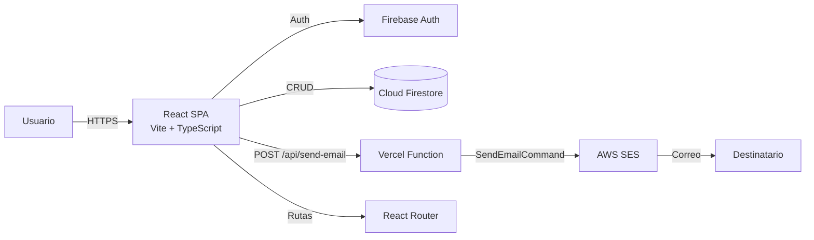
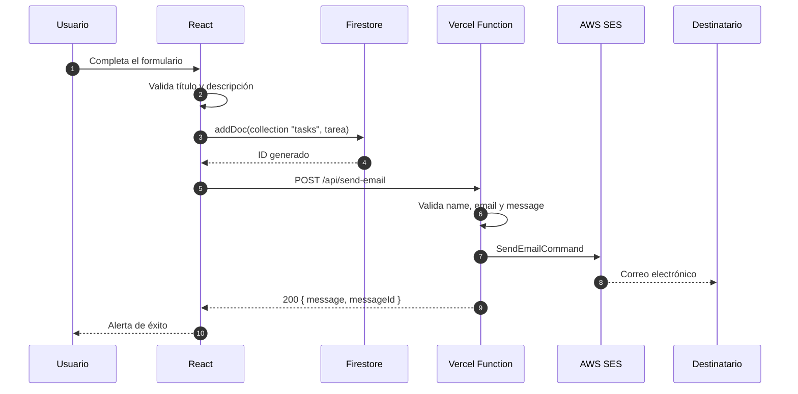
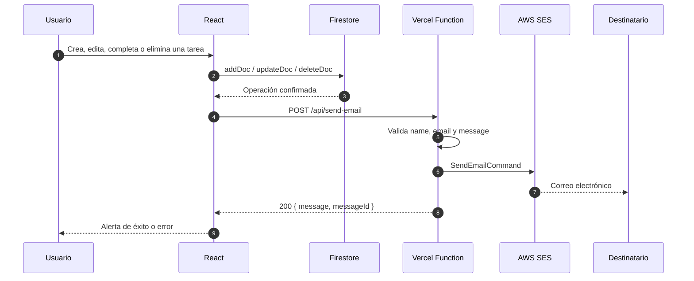
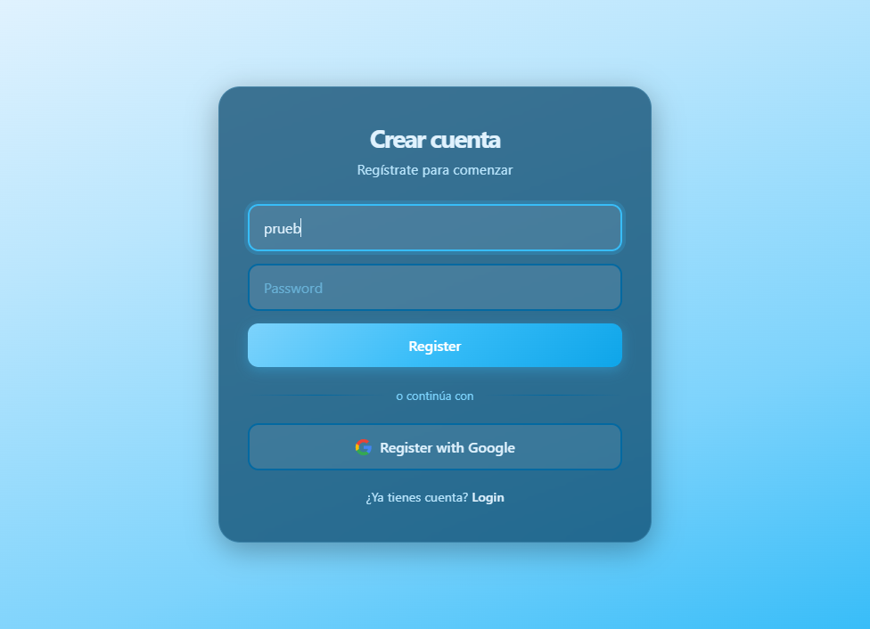
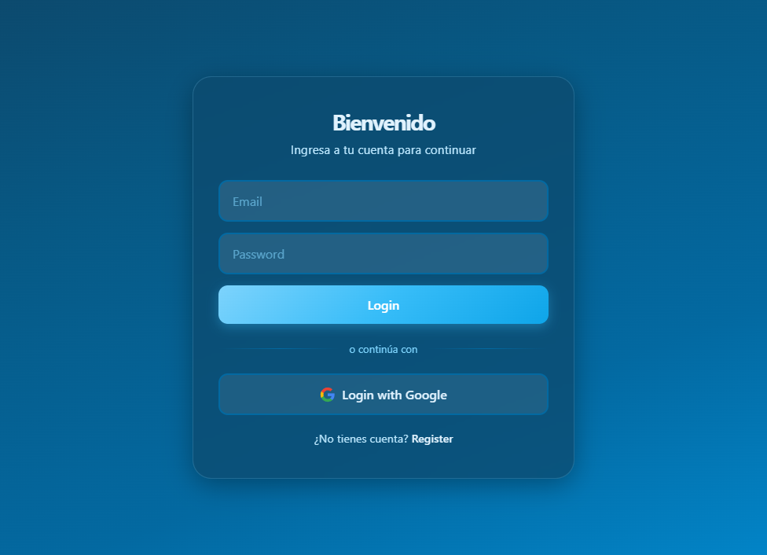
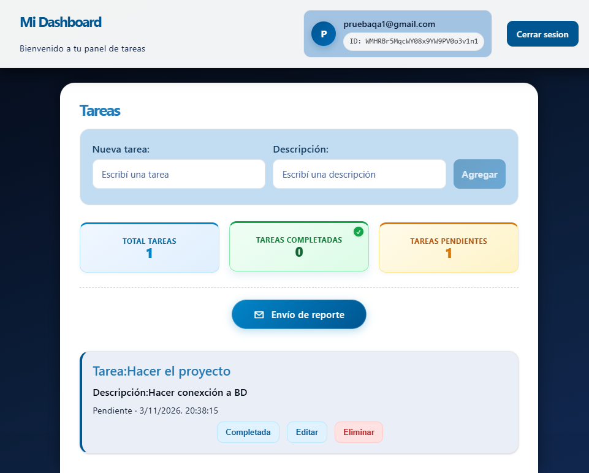
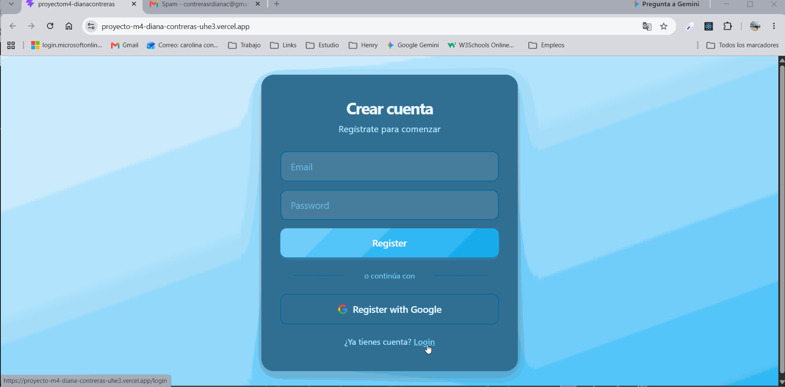

# ✅ TODO App — Proyecto M4

[](https://react.dev/)
[](https://www.typescriptlang.org/)
[](https://vite.dev/)
[](https://firebase.google.com/)
[](https://aws.amazon.com/ses/)
[](https://vercel.com/)
[](https://vitest.dev/)

> Aplicación TODO full stack desarrollada como proyecto del **Módulo 4**. Combina React + TypeScript en el frontend, Firebase para autenticación y base de datos, AWS SES para el envío de correos y Vercel para el despliegue.

> 📌 **Nota:** Este README documenta el estado actual del proyecto. Algunas secciones incluyen **recomendaciones** que todavía no están implementadas en el código; se indican claramente como tales.

---

## 📋 Tabla de contenido

1. [🧭 Introducción del proyecto](#introduccion)
2. [📝 Descripción del proyecto](#descripcion)
3. [🧪 Cómo probar la aplicación (evaluación)](#evaluacion)
4. [✨ Funcionalidades](#funcionalidades)
5. [🛠️ Tecnologías utilizadas / Stack tecnológico](#stack)
6. [🏗️ Arquitectura y decisiones](#arquitectura)
7. [📦 Instalación](#instalacion)
8. [💻 Pasos para el despliegue local](#local)
9. [▲ Pasos para el despliegue en Vercel](#vercel)
10. [🔗 URLs de despliegue](#urls)
11. [🗂️ Scaffolding](#scaffolding)
12. [🔥 Pasos para configurar Firebase](#firebase)
13. [🗄️ Pasos para configurar Firestore](#firestore)
14. [☁️ Pasos para configurar AWS](#aws)
15. [🚀 Pasos para desplegar la app en Vercel](#desplegar-vercel)
16. [🔐 Variables de entorno](#variables)
17. [⚙️ Configuración de los servicios](#servicios)
18. [📧 Flujo de envío de emails](#emails)
19. [🛡️ Seguridad](#seguridad)
20. [🖼️ Pantallas de cada vista y demo](#pantallas)
21. [🧪 Descripción de cómo generar los tests](#tests)
22. [⚠️ Limitaciones conocidas](#limitaciones)
23. [🤖 Prompts utilizados en el desarrollo](#prompts)
24. [👩‍💻 Autor](#autor)

---

<a id="introduccion"></a>
## 🧭 Introducción del proyecto

**TODO App — Proyecto M4** es una aplicación web para gestionar tareas personales. Fue desarrollada como parte del proceso de aprendizaje de **desarrollo full stack**, con el objetivo de practicar:

- Componentes, estado y efectos de **React**.
- Tipado estricto con **TypeScript**.
- Autenticación real con **Firebase Auth**.
- Operaciones CRUD contra **Cloud Firestore**.
- Creación de una **función serverless** en Vercel.
- Envío de correos transaccionales con **AWS SES**.
- Pruebas automatizadas con **Vitest** y **Testing Library**.
- Despliegue en producción con **Vercel**.

El proyecto prioriza la claridad y el aprendizaje sobre la complejidad: usa estado local de React, una capa de servicios para Firestore y CSS separado por página, sin librerías adicionales de estado o de estilos.

---

<a id="descripcion"></a>
## 📝 Descripción del proyecto

La aplicación permite que cada usuario registrado gestione su propio tablero de tareas:

- Se registra o inicia sesión con **email/contraseña** o con **Google**.
- Crea tareas con **título** y **descripción** (ambos obligatorios, mínimo 2 caracteres).
- Visualiza sus tareas ordenadas de la más reciente a la más antigua.
- Edita el título y la descripción **en línea**, sin salir de la tarjeta.
- Marca una tarea como **completada** o la devuelve a **pendiente**.
- Elimina tareas.
- Consulta un resumen con el **total**, las **completadas** y las **pendientes**.
- Solicita un **reporte por correo** con el resumen actual.
- Recibe alertas visuales independientes para el alta de tareas y para el envío de reportes.

Cada tarea se guarda en Firestore con el `userId` del usuario autenticado, por lo que **cada persona ve únicamente sus propias tareas**.

La interfaz es responsive, incluye soporte para **modo oscuro** mediante `prefers-color-scheme` y utiliza mensajes accesibles con `role="alert"` y `role="status"`.

---

<a id="evaluacion"></a>
## 🧪 Cómo probar la aplicación (evaluación)

### 🌐 Opción 1: probar la versión desplegada

1. Abre la aplicación en producción:
   **https://proyecto-m4-diana-contreras-uhe3.vercel.app**
2. En la pantalla de **Registro**, crea una cuenta con un correo real o usa **Register with Google**.
3. Si ya tienes cuenta, entra desde **Login**.
4. Crea una tarea escribiendo un título y una descripción de **al menos 2 caracteres**.
5. Prueba el flujo completo:
   - Editar una tarea.
   - Marcarla como completada y devolverla a pendiente.
   - Eliminarla.
   - Enviar el reporte por correo.
6. Revisa el correo configurado en `SES_TO_EMAIL`.

> ⚠️ **Importante:** en modo *sandbox* de AWS SES, solo se pueden enviar correos a direcciones verificadas. Si el correo no llega, revisa la sección [☁️ Configuración de AWS](#aws).

> 🔐 **Cuentas de prueba:** por seguridad, este README no publica credenciales. El evaluador debe crear una cuenta nueva o usar las credenciales entregadas por el autor por un canal privado.

### 💻 Opción 2: probar en local

Sigue los pasos de [💻 Despliegue local](#local). Ten en cuenta que `npm run dev` **no ejecuta** la función `/api/send-email`; para probar el correo en local necesitas `npm run dev:vercel`.

### ✅ Checklist de evaluación

- [ ] Registro con email y contraseña.
- [ ] Registro con Google.
- [ ] Inicio de sesión.
- [ ] Cierre de sesión.
- [ ] Protección de la ruta `/dashboard` sin sesión.
- [ ] Creación de tarea con título y descripción válidos.
- [ ] Validación de campos vacíos o con menos de 2 caracteres.
- [ ] Botón **Agregar** deshabilitado cuando el formulario es inválido.
- [ ] Edición en línea de título y descripción.
- [ ] Cambio de estado completada/pendiente.
- [ ] Eliminación de tarea.
- [ ] Tarjetas de resumen actualizadas.
- [ ] Envío de reporte por correo.
- [ ] Alertas independientes para tarea y reporte.
- [ ] Diseño responsive.
- [ ] Modo oscuro del sistema operativo.

---

<a id="funcionalidades"></a>
## ✨ Funcionalidades

### 🔐 Autenticación

- Registro con email y contraseña.
- Inicio de sesión con email y contraseña.
- Inicio de sesión con Google.
- Cierre de sesión.
- Persistencia de sesión mediante `onAuthStateChanged`.
- Mensajes de error traducidos al español (`authErrors.ts`).
- Mensaje de éxito al registrarse.

### 📝 Gestión de tareas

- Crear tareas con título y descripción.
- Listar tareas del usuario autenticado.
- Orden cronológico descendente por `createdAt`.
- Edición en línea de título y descripción.
- Cambio de estado entre completada y pendiente.
- Eliminación de tareas.
- Contadores de total, completadas y pendientes.

### ✅ Validación del formulario

- Título y descripción obligatorios.
- Mínimo 2 caracteres, ignorando espacios al inicio y al final.
- Mensajes de error debajo de cada campo.
- Borde rojo en los campos inválidos.
- Botón **Agregar** deshabilitado mientras el formulario no sea válido.
- Guarda de seguridad en `handleSubmit` para evitar altas inválidas.

### 📧 Notificaciones por correo

- Correo al crear una tarea.
- Reporte general con el resumen de tareas.
- Correo al completar o devolver una tarea a pendiente.
- Correo al eliminar una tarea.
- Alertas visuales independientes para el alta de tarea y el envío de reporte.
- Auto-ocultado de las alertas a los 4 segundos.

### 🎨 Interfaz

- Diseño responsive (móvil y escritorio).
- Modo claro y oscuro según el sistema operativo.
- Tarjetas de resumen con colores por estado.
- Mensajes accesibles (`role="status"` y `role="alert"`).
- Componente reutilizable `Button` con variantes `default`, `ghost`, `danger` y `google`.

---

<a id="stack"></a>
## 🛠️ Tecnologías utilizadas / Stack tecnológico

| Categoría | Tecnología | Versión | Uso |
|---|---|---|---|
| Frontend | React | 19.2.8 | Interfaz de usuario |
| Lenguaje | TypeScript | ~6.0.2 | Tipado estático |
| Bundler | Vite | 8.3.0 | Desarrollo y build |
| Ruteo | React Router DOM | 7.18.3 | Rutas SPA |
| Autenticación | Firebase Auth | 12.19.0 | Email/contraseña y Google |
| Base de datos | Cloud Firestore | 12.19.0 | Persistencia de tareas |
| Email | AWS SES | SDK 3.1162.0 | Envío de correos |
| Serverless | Vercel Functions | `@vercel/node` 29.0.1 | Endpoint `/api/send-email` |
| Testing | Vitest | 5.1.0 | Runner de pruebas |
| Testing | Testing Library | 16.3.3 | Pruebas de componentes |
| Testing | jsdom | 31.0.0 | Entorno DOM |
| Calidad | ESLint | 10.10.0 | Linting |
| Calidad | typescript-eslint | 8.69.0 | Reglas para TypeScript |
| Despliegue | Vercel | — | Hosting y funciones |
| Estilos | CSS puro | — | `index.css` + CSS por página |

### 📦 Dependencias de producción

```json
{
  "@aws-sdk/client-ses": "^3.1162.0",
  "firebase": "^12.19.0",
  "react": "^19.2.8",
  "react-dom": "^19.2.8",
  "react-router-dom": "^7.18.3"
}
```

### 🧰 Dependencias de desarrollo

```json
{
  "@eslint/js": "^10.0.1",
  "@testing-library/jest-dom": "^7.0.1",
  "@testing-library/react": "^16.3.3",
  "@testing-library/user-event": "^14.6.9",
  "@types/node": "^24.13.3",
  "@types/react": "^19.2.18",
  "@types/react-dom": "^19.2.7",
  "@vercel/node": "^29.0.1",
  "@vitejs/plugin-react": "^6.1.1",
  "eslint": "^10.10.0",
  "eslint-plugin-react-hooks": "^7.1.1",
  "eslint-plugin-react-refresh": "^0.5.6",
  "globals": "^17.12.0",
  "jsdom": "^31.0.0",
  "typescript": "~6.0.2",
  "typescript-eslint": "^8.69.0",
  "vite": "^8.3.0",
  "vitest": "^5.1.0"
}
```

---

<a id="arquitectura"></a>
## 🏗️ Arquitectura y decisiones

### 🧩 Visión general



### 🗂️ Organización del código

| Capa | Archivos | Responsabilidad |
|---|---|---|
| Entrada | `src/main.tsx` | Monta React, `BrowserRouter` y `Authenticator` |
| Rutas | `src/App.tsx` | Define `/`, `/login` y `/dashboard` |
| Protección | `src/components/RequireAuth.tsx` | Redirige a `/login` si no hay sesión |
| Autenticación | `src/features/auth/Authenticator.tsx` | Contexto de auth y hook `useAuth` |
| Errores de auth | `src/features/auth/authErrors.ts` | Traduce códigos de Firebase |
| Páginas | `src/pages/*` | Registro, login y dashboard |
| Servicios | `src/services/Firebase.tsx` | Inicializa Firebase Auth y Firestore |
| Servicios | `src/services/taskServices.ts` | CRUD de tareas en Firestore |
| Tipos | `src/types/types.ts` | `Task` y `NexTask` |
| UI | `src/ui/Button/*` | Botón reutilizable con variantes |
| API | `api/send-email.ts` | Función serverless de AWS SES |
| Tests | `src/__tests__/basic.test.tsx` | Pruebas de componentes y flujo |

### 🧠 Decisiones principales

1. **SPA con React Router.** La app no recarga la página al navegar. Las rutas se resuelven en el cliente.
2. **Contexto para la autenticación.** `Authenticator` envuelve toda la app y expone `user`, `loading`, `signUp`, `signIn`, `signInWithGoogle` y `logout`. Así cualquier componente accede al usuario sin prop drilling.
3. **Capa de servicios para Firestore.** `taskServices.ts` aísla las llamadas a Firebase. Los componentes no conocen los detalles de `addDoc`, `updateDoc` o `deleteDoc`.
4. **Función serverless para el correo.** Las credenciales de AWS **nunca** llegan al navegador. El frontend llama a `/api/send-email` y Vercel ejecuta la función con las variables de entorno del servidor.
5. **Estado local de React.** No se usa Redux, Zustand ni React Query porque el alcance del proyecto no lo requiere. Las tareas viven en `DashboardPage` y se actualizan con `useState`.
6. **CSS separado por página.** `DashboardPage.css`, `LoginPage.css` y `SignUp.css` mantienen los estilos cerca de su vista. `index.css` define variables globales y el tema oscuro.
7. **Validación en dos niveles.** El formulario deshabilita el botón y muestra mensajes por campo; además, `handleSubmit` vuelve a validar antes de llamar a `addTask`.
8. **Consultas por usuario.** Firestore filtra con `where("userId", "==", userId)` y ordena con `orderBy("createdAt", "desc")`. Esto requiere un índice compuesto (ver [Firestore](#firestore)).

### 🔄 Flujo de datos de una tarea



### ⚖️ Trade-offs asumidos

- **Simplicidad sobre escalabilidad:** no hay caché ni estado global; cada carga del dashboard consulta Firestore.
- **Correo acoplado al alta:** si el correo falla después de crear la tarea, la tarea ya quedó guardada pero la UI muestra un error general. Una mejora futura sería desacoplar ambas operaciones.
- **Rutas protegidas en el cliente:** `RequireAuth` mejora la experiencia, pero la seguridad real debe estar en las reglas de Firestore.

---

<a id="instalacion"></a>
## 📦 Instalación

### ✅ Requisitos previos

| Herramienta | Versión recomendada |
|---|---|
| Node.js | `^20.19.0` o `>=22.12.0` (probado con Node 24) |
| npm | 10 o superior |
| Git | Cualquier versión reciente |
| Cuenta de Firebase | Necesaria para auth y Firestore |
| Cuenta de AWS | Necesaria para SES |
| Cuenta de Vercel | Necesaria para desplegar |

> Vite 8 exige Node `^20.19.0 || >=22.12.0`. Si usas una versión anterior, el build puede fallar.

### 📥 Instalar todas las dependencias

Desde la raíz del proyecto:

```bash
npm install
```

Ese comando instala **todas** las dependencias de `package.json` (producción y desarrollo). No hace falta instalarlas una por una.

Si quieres recrear la instalación desde cero, estos son los paquetes que usa el proyecto:

```bash
# Dependencias de producción
npm install react react-dom react-router-dom firebase @aws-sdk/client-ses

# Dependencias de desarrollo
npm install -D typescript vite @vitejs/plugin-react @types/react @types/react-dom @types/node @vercel/node vitest jsdom @testing-library/react @testing-library/jest-dom @testing-library/user-event eslint @eslint/js typescript-eslint eslint-plugin-react-hooks eslint-plugin-react-refresh globals
```

### 🌍 Instalar la CLI de Vercel (opcional, para probar la API en local)

```bash
npm install -g vercel
```

### 📜 Scripts disponibles

| Script | Comando | Descripción |
|---|---|---|
| `dev` | `npm run dev` | Servidor de desarrollo de Vite |
| `dev:vercel` | `npm run dev:vercel` | Servidor de Vercel con funciones serverless |
| `build` | `npm run build` | Compila TypeScript y genera `dist/` |
| `preview` | `npm run preview` | Sirve el build de producción |
| `lint` | `npm run lint` | Ejecuta ESLint |
| `test` | `npm test` | Ejecuta Vitest |
| `test:watch` | `npm run test:watch` | Ejecuta Vitest en modo watch |

---

<a id="local"></a>
## 💻 Pasos para el despliegue local

### 1️⃣ Clonar el repositorio

```bash
git clone https://github.com/contrerasrdianac406/ProyectoM4_DianaContreras.git
cd ProyectoM4_DianaContreras
```

### 2️⃣ Instalar dependencias

```bash
npm install
```

### 3️⃣ Crear el archivo `.env`

Copia el ejemplo y completa los valores:

```bash
copy .env.example .env
```

En macOS/Linux:

```bash
cp .env.example .env
```

Contenido recomendado:

```env
# Firebase (cliente)
VITE_FIREBASE_API_KEY=tu_api_key
VITE_FIREBASE_AUTH_DOMAIN=tu-proyecto.firebaseapp.com
VITE_FIREBASE_PROJECT_ID=tu-proyecto
VITE_FIREBASE_APP_ID=1:123456789:web:abcdef

# AWS SES (servidor)
AWS_REGION=us-east-1
AWS_ACCESS_KEY_ID=tu_access_key_id
AWS_SECRET_ACCESS_KEY=tu_secret_access_key
SES_FROM_EMAIL=correo-verificado@tudominio.com
SES_TO_EMAIL=destinatario@example.com
```

> ⚠️ El `.env.example` actual tiene los **nombres** correctos, pero algunos **valores** de ejemplo están mal escritos (por ejemplo `VITE_FIREBASE_API_KEY=AVITE_FIREBASE_API_KEY` y `VITE_FIREBASE_PROJECT_ID=sVITE_FIREBASE_PROJECT_ID`), y `AWS_REGION` incluye texto extra. Reemplaza cada valor por el real usando la tabla de [Variables de entorno](#variables) como referencia.

### 4️⃣ Opción A: solo frontend

```bash
npm run dev
```

Abre **http://localhost:5173**.

> ⚠️ Con `npm run dev`, Vite **no ejecuta** la carpeta `api/`. El `fetch("/api/send-email")` devolverá 404 y el correo no se enviará. Las tareas sí se guardan en Firestore.

### 5️⃣ Opción B: frontend + API de email

Necesitas la CLI de Vercel:

```bash
npm install -g vercel
vercel login
vercel link
npm run dev:vercel
```

Abre la URL que indique Vercel (normalmente **http://localhost:3000**).

Si el proyecto está vinculado, también puedes traer las variables de entorno:

```bash
vercel env pull .env.local
```

### 6️⃣ Verificar el build de producción

```bash
npm run build
npm run preview
```

El build genera la carpeta `dist/`.

### 7️⃣ Ejecutar lint y tests

```bash
npm run lint
npm test
```

---

<a id="vercel"></a>
## ▲ Pasos para el despliegue en Vercel

### 🌐 Opción A: desde el panel de Vercel (recomendada para empezar)

1. Sube el proyecto a GitHub.
2. Entra a [vercel.com](https://vercel.com/) e inicia sesión.
3. Haz clic en **Add New → Project**.
4. Importa el repositorio `ProyectoM4_DianaContreras`.
5. Configura:
   - **Framework Preset:** Vite.
   - **Build Command:** `npm run build`.
   - **Output Directory:** `dist`.
   - **Install Command:** `npm install`.
   - **Node.js Version:** 22.x (o 20.x).
6. Agrega las [variables de entorno](#variables) en **Settings → Environment Variables**.
7. Haz clic en **Deploy**.
8. Vercel detecta automáticamente `api/send-email.ts` como función serverless.

### 💻 Opción B: desde la CLI

```bash
npm install -g vercel
vercel login
vercel link
vercel env add VITE_FIREBASE_API_KEY
vercel env add VITE_FIREBASE_AUTH_DOMAIN
vercel env add VITE_FIREBASE_PROJECT_ID
vercel env add VITE_FIREBASE_APP_ID
vercel env add AWS_REGION
vercel env add AWS_ACCESS_KEY_ID
vercel env add AWS_SECRET_ACCESS_KEY
vercel env add SES_FROM_EMAIL
vercel env add SES_TO_EMAIL
vercel --prod
```

### 🔁 Fallback para rutas SPA (obligatorio para `/login` y `/dashboard`)

La app usa `BrowserRouter`. En Vercel, si entras directamente a `https://tu-app.vercel.app/login` o `/dashboard`, el servidor devuelve **404** porque no existe un archivo físico para esas rutas. La navegación desde `/` sí funciona porque ocurre en el cliente.

**Solución recomendada:** crea un archivo `vercel.json` en la raíz:

```json
{
  "rewrites": [
    { "source": "/login", "destination": "/index.html" },
    { "source": "/dashboard", "destination": "/index.html" }
  ]
}
```

Luego vuelve a desplegar. Si agregas más rutas en el futuro, agrégalas también aquí.

**Alternativa con catch-all:**

```json
{
  "routes": [
    { "handle": "filesystem" },
    { "src": "/.*", "dest": "/index.html" }
  ]
}
```

Esta variante sirve primero los archivos y funciones existentes (incluida `/api/send-email`) y, si no encuentra nada, entrega `index.html` para que React Router resuelva la ruta.

> ✅ **Verificado:** la URL actual responde en `/`, pero `/login` y `/dashboard` devuelven 404. Agregar `vercel.json` corrige el problema.

---

<a id="urls"></a>
## 🔗 URLs de despliegue

| Recurso | URL |
|---|---|
| 🚀 Producción | https://proyecto-m4-diana-contreras-uhe3.vercel.app |
| 💻 Repositorio GitHub | https://github.com/contrerasrdianac406/ProyectoM4_DianaContreras |
| 📁 Proyecto en Vercel | Panel de Vercel → proyecto `proyecto-m4-diana-contreras` |


> ⚠️ Recuerda agregar `vercel.json` para que `/login` y `/dashboard` funcionen al entrar directamente.

---

<a id="scaffolding"></a>
## 🗂️ Scaffolding

```text
ProyectoM4_DianaContreras/
├── api/
│   └── send-email.ts              # Función serverless: valida y envía correos con AWS SES
├── docs/
│   └── screenshots/
│       ├── registro.png           # Captura de la vista de registro
│       ├── login.png              # Captura de la vista de login
│       └── dashboard.png          # Captura del dashboard
├── public/
│   ├── favicon.svg
│   └── icons.svg
├── src/
│   ├── __tests__/
│   │   └── basic.test.tsx         # Pruebas con Vitest + Testing Library
│   ├── assets/
│   │   ├── hero.png
│   │   ├── react.svg
│   │   └── vite.svg
│   ├── components/
│   │   └── RequireAuth.tsx        # Protege /dashboard
│   ├── features/
│   │   └── auth/
│   │       ├── Authenticator.tsx  # Contexto de auth + hook useAuth
│   │       └── authErrors.ts      # Traducción de errores de Firebase
│   ├── hooks/
│   │   ├── useAuth.tsx            # (vacío; el hook real está en Authenticator.tsx)
│   │   └── useTasks.tsx           # (vacío; la lógica está en DashboardPage)
│   ├── pages/
│   │   ├── DashboardPage.tsx      # CRUD de tareas, reportes y alertas
│   │   ├── DashboardPage.css
│   │   ├── LoginPage.tsx
│   │   ├── LoginPage.css
│   │   ├── SignUp.tsx
│   │   └── SignUp.css
│   ├── routes/
│   │   └── ProtectedRoute.tsx     # (no se usa actualmente; App usa RequireAuth)
│   ├── services/
│   │   ├── Firebase.tsx           # Inicializa Firebase Auth y Firestore
│   │   └── taskServices.ts        # CRUD contra Firestore
│   ├── types/
│   │   └── types.ts               # Task y NexTask
│   ├── ui/
│   │   └── Button/
│   │       ├── Button.tsx
│   │       └── Button.css
│   ├── App.tsx                    # Rutas de la aplicación
│   ├── App.css
│   ├── index.css                  # Variables globales y tema oscuro
│   ├── main.tsx                   # Punto de entrada
│   └── setupTests.ts              # Configuración de jest-dom
├── .env.example                   # Plantilla de variables de entorno
├── .gitignore
├── eslint.config.js
├── index.html
├── package.json
├── package-lock.json
├── tsconfig.json
├── tsconfig.app.json
├── tsconfig.node.json
├── vite.config.ts                 # Configuración de Vite + Vitest
└── README.md
```

### 📌 Notas del scaffolding

- `src/hooks/useAuth.tsx` y `src/hooks/useTasks.tsx` están **vacíos**. El hook de autenticación real se exporta desde `src/features/auth/Authenticator.tsx`.
- `src/routes/ProtectedRoute.tsx` existe pero **no se usa**: `App.tsx` protege `/dashboard` con `src/components/RequireAuth.tsx`.
- `src/assets/hero.png`, `react.svg` y `vite.svg` son restos de la plantilla de Vite y no se usan en las vistas actuales.

---

<a id="firebase"></a>
## 🔥 Pasos para configurar Firebase

### 1️⃣ Crear el proyecto

1. Entra a [console.firebase.google.com](https://console.firebase.google.com/).
2. Haz clic en **Agregar proyecto**.
3. Asigna un nombre (por ejemplo, `proyecto-m4-diana-contreras`).
4. Puedes desactivar Google Analytics si no lo necesitas.

### 2️⃣ Registrar la app web

1. En la página principal del proyecto, haz clic en el ícono **Web** (`</>`).
2. Asigna un nombre a la app.
3. Copia el objeto `firebaseConfig` que muestra Firebase:

```js
const firebaseConfig = {
  apiKey: "...",
  authDomain: "...",
  projectId: "...",
  appId: "...",
};
```

4. Esos valores van en las variables `VITE_FIREBASE_*` de tu `.env`.

### 3️⃣ Habilitar Authentication

1. Ve a **Build → Authentication**.
2. Haz clic en **Comenzar**.
3. En **Sign-in method**, habilita:
   - **Email/Password**.
   - **Google** (configura el correo de soporte del proyecto).
4. En **Settings → Authorized domains**, verifica que estén:
   - `localhost`
   - `127.0.0.1`
   - `proyecto-m4-diana-contreras-uhe3.vercel.app`
   - Tu dominio personalizado, si lo agregas.

### 4️⃣ Crear la base de datos

1. Ve a **Build → Firestore Database**.
2. Haz clic en **Crear base de datos**.
3. Elige una ubicación cercana a tus usuarios.
4. Empieza en **modo de producción** y luego aplica las reglas de la sección [Firestore](#firestore).

### 5️⃣ Completar las variables de entorno

```env
VITE_FIREBASE_API_KEY=...
VITE_FIREBASE_AUTH_DOMAIN=...
VITE_FIREBASE_PROJECT_ID=...
VITE_FIREBASE_APP_ID=...
```

Reinicia el servidor de desarrollo después de cambiar `.env`.

### 🔐 ¿La API key de Firebase es secreta?

No. La `apiKey` de Firebase es pública por diseño y se incluye en el bundle del navegador. La seguridad real depende de:

- Las **reglas de Firestore**.
- Los **dominios autorizados** de Authentication.
- Las reglas de **Firebase Security Rules**.

---

<a id="firestore"></a>
## 🗄️ Pasos para configurar Firestore

### 1️⃣ Colección `tasks`

La colección se crea automáticamente al guardar la primera tarea. Cada documento tiene esta estructura:

| Campo | Tipo | Descripción |
|---|---|---|
| `id` | `string` | ID del documento (lo genera Firestore) |
| `title` | `string` | Título de la tarea |
| `description` | `string` | Descripción |
| `completed` | `boolean` | `true` si está completada |
| `userId` | `string` | UID del usuario autenticado |
| `createdAt` | `string` | Fecha ISO 8601 (`new Date().toISOString()`) |

> `NexTask` es `Omit<Task, "id">` porque el ID lo genera Firestore al crear el documento.

### 2️⃣ Índice compuesto obligatorio

La consulta del dashboard es:

```ts
query(
  collection(db, "tasks"),
  where("userId", "==", userId),
  orderBy("createdAt", "desc")
)
```

Firestore necesita un **índice compuesto** para combinar un filtro de igualdad con un ordenamiento. Si no existe, la primera consulta falla y la consola muestra un enlace para crearlo.

Créalo manualmente:

1. Ve a **Firestore Database → Indexes**.
2. Haz clic en **Composite**.
3. Configura:
   - **Collection ID:** `tasks`
   - **Query scope:** Collection
   - **Fields:**
     - `userId` — Ascending
     - `createdAt` — Descending
4. Guarda y espera a que el índice pase a estado **Enabled**.

### 3️⃣ Reglas de seguridad recomendadas

> ⚠️ **Recomendación:** el repositorio no incluye un archivo `firestore.rules`. Estas reglas deben pegarse en **Firestore Database → Rules**.

```js
rules_version = '2';

service cloud.firestore {
  match /databases/{database}/documents {
    match /tasks/{taskId} {
      // Leer y eliminar solo las tareas propias
      allow read, delete: if request.auth != null
        && request.auth.uid == resource.data.userId;

      // Crear solo tareas cuyo userId sea el del usuario autenticado
      allow create: if request.auth != null
        && request.auth.uid == request.resource.data.userId;

      // Actualizar solo tareas propias y sin cambiar el dueño
      allow update: if request.auth != null
        && request.auth.uid == resource.data.userId
        && request.auth.uid == request.resource.data.userId;
    }
  }
}
```

Estas reglas garantizan que:

- Un usuario no pueda leer tareas de otro.
- Un usuario no pueda crear tareas a nombre de otro.
- Un usuario no pueda cambiar el `userId` de una tarea existente.

### 4️⃣ Verificar la conexión

1. Inicia sesión en la app.
2. Crea una tarea.
3. En Firebase Console → Firestore Database, abre la colección `tasks`.
4. Deberías ver el documento con tu `userId`.

---

<a id="aws"></a>
## ☁️ Pasos para configurar AWS

El envío de correos usa **Amazon Simple Email Service (SES)** desde la función `api/send-email.ts`.

### 1️⃣ Crear la cuenta de AWS

1. Entra a [aws.amazon.com](https://aws.amazon.com/) y crea una cuenta.
2. Inicia sesión en la consola.

### 2️⃣ Verificar el correo remitente en SES

1. Ve a **Amazon SES → Verified identities**.
2. Haz clic en **Create identity**.
3. Elige **Email address**.
4. Ingresa el correo que usarás como remitente (`SES_FROM_EMAIL`).
5. Revisa tu bandeja y haz clic en el enlace de verificación.

> ⚠️ **Modo sandbox:** si tu cuenta SES está en sandbox, también debes verificar el correo destinatario (`SES_TO_EMAIL`). En producción, solicita el acceso a producción para enviar a cualquier dirección.

### 3️⃣ Crear un usuario IAM con permisos de SES

1. Ve a **IAM → Users → Create user**.
2. Asigna un nombre (por ejemplo, `todo-app-ses`).
3. Selecciona **Programmatic access** (access key).
4. Adjunta una política. Para simplificar, puedes usar `AmazonSESFullAccess`. Para un entorno real, usa permisos mínimos:

```json
{
  "Version": "2012-10-17",
  "Statement": [
    {
      "Effect": "Allow",
      "Action": [
        "ses:SendEmail",
        "ses:SendRawEmail"
      ],
      "Resource": "*"
    }
  ]
}
```

5. Crea el usuario y guarda:
   - **Access key ID** → `AWS_ACCESS_KEY_ID`
   - **Secret access key** → `AWS_SECRET_ACCESS_KEY`

> 🔐 Nunca subas estas credenciales al repositorio. Van únicamente en `.env` o en las variables de Vercel.

### 4️⃣ Configurar las variables

```env
AWS_REGION=us-east-1
AWS_ACCESS_KEY_ID=tu_access_key_id
AWS_SECRET_ACCESS_KEY=tu_secret_access_key
SES_FROM_EMAIL=correo-verificado@tudominio.com
SES_TO_EMAIL=destinatario@example.com
```

- `AWS_REGION` debe coincidir con la región donde verificaste el correo en SES.
- El SDK de AWS toma `AWS_ACCESS_KEY_ID` y `AWS_SECRET_ACCESS_KEY` automáticamente del entorno.

### 5️⃣ Solicitar acceso a producción (opcional)

Por defecto, SES está en sandbox y solo envía a direcciones verificadas. Si necesitas enviar a cualquier correo:

1. Ve a **SES → Account dashboard**.
2. Haz clic en **Request production access**.
3. Completa el formulario con el uso previsto.

### 6️⃣ Probar el envío

1. Ejecuta `npm run dev:vercel`.
2. Crea una tarea.
3. Revisa el correo de `SES_TO_EMAIL`.
4. Si falla, revisa los logs de la función en Vercel o la consola local.

---

<a id="desplegar-vercel"></a>
## 🚀 Pasos para desplegar la app en Vercel

Esta sección complementa el [despliegue inicial](#vercel) y cubre las actualizaciones.

### 🔁 Despliegue automático

1. Conecta el repositorio de GitHub a Vercel.
2. Cada `push` a la rama `main` genera un despliegue de producción.
3. Cada pull request genera un **Preview Deployment**.

### 🛠️ Despliegue manual

```bash
vercel --prod
```

### 🔑 Variables de entorno en Vercel

1. Entra al proyecto en Vercel.
2. Ve a **Settings → Environment Variables**.
3. Agrega las 9 variables de la sección [Variables de entorno](#variables).
4. Marca los entornos:
   - **Production**
   - **Preview**
   - **Development** (opcional)
5. Vuelve a desplegar para que los cambios surtan efecto.

### 🧪 Verificar la función serverless

1. En Vercel, abre el proyecto.
2. Ve a **Deployments → Functions**.
3. Confirma que `api/send-email` aparece como función.
4. Revisa los **Logs** si el correo falla.

### 🌐 Configurar el dominio

1. Ve a **Settings → Domains**.
2. Agrega tu dominio personalizado si lo tienes.
3. Actualiza los **Authorized domains** de Firebase con el nuevo dominio.

### 🩺 Checklist posterior al despliegue

- [ ] La página principal carga.
- [ ] `/login` y `/dashboard` funcionan al entrar directamente (requiere `vercel.json`).
- [ ] El registro con email funciona.
- [ ] El login con Google funciona.
- [ ] Las tareas se guardan en Firestore.
- [ ] El reporte por correo llega a `SES_TO_EMAIL`.
- [ ] Los logs de la función no muestran errores.

---

<a id="variables"></a>
## 🔐 Variables de entorno

### 📄 Archivo local `.env`

```env
# Firebase (se expone al cliente)
VITE_FIREBASE_API_KEY=tu_api_key
VITE_FIREBASE_AUTH_DOMAIN=tu-proyecto.firebaseapp.com
VITE_FIREBASE_PROJECT_ID=tu-proyecto
VITE_FIREBASE_APP_ID=1:123456789:web:abcdef

# AWS SES (solo servidor)
AWS_REGION=us-east-1
AWS_ACCESS_KEY_ID=tu_access_key_id
AWS_SECRET_ACCESS_KEY=tu_secret_access_key
SES_FROM_EMAIL=correo-verificado@tudominio.com
SES_TO_EMAIL=destinatario@example.com
```

### 📊 Tabla de variables

| Variable | Ámbito | Dónde se usa | Descripción |
|---|---|---|---|
| `VITE_FIREBASE_API_KEY` | Cliente | `src/services/Firebase.tsx` | API key de la app web de Firebase |
| `VITE_FIREBASE_AUTH_DOMAIN` | Cliente | `src/services/Firebase.tsx` | Dominio de autenticación |
| `VITE_FIREBASE_PROJECT_ID` | Cliente | `src/services/Firebase.tsx` | ID del proyecto de Firebase |
| `VITE_FIREBASE_APP_ID` | Cliente | `src/services/Firebase.tsx` | ID de la app web |
| `AWS_REGION` | Servidor | `api/send-email.ts` | Región de SES |
| `AWS_ACCESS_KEY_ID` | Servidor | SDK de AWS | Access key del usuario IAM |
| `AWS_SECRET_ACCESS_KEY` | Servidor | SDK de AWS | Secret key del usuario IAM |
| `SES_FROM_EMAIL` | Servidor | `api/send-email.ts` | Remitente verificado en SES |
| `SES_TO_EMAIL` | Servidor | `api/send-email.ts` | Destinatario de los correos |

### ⚠️ Reglas importantes

- Las variables que empiezan con `VITE_` **se incluyen en el bundle del navegador**. Son públicas.
- **Nunca** pongas `AWS_SECRET_ACCESS_KEY` en una variable `VITE_*`.
- El archivo `.env` está ignorado por Git.
- En Vercel, las variables se configuran en **Settings → Environment Variables**.
- Si cambias una variable `VITE_*`, reinicia el servidor de desarrollo.

---

<a id="servicios"></a>
## ⚙️ Configuración de los servicios

| Servicio | Para qué se usa | Dónde se configura |
|---|---|---|
| **Firebase Auth** | Registro, login y sesión | Firebase Console → Authentication |
| **Cloud Firestore** | Persistencia de tareas | Firebase Console → Firestore Database |
| **AWS SES** | Envío de correos | AWS Console → SES + IAM |
| **Vercel Functions** | Endpoint `/api/send-email` | Carpeta `api/` + Vercel |
| **Vercel Hosting** | Frontend estático | Proyecto de Vercel |

### 🔌 Cómo se conectan

```text
src/services/Firebase.tsx
  ├── initializeApp(firebaseConfig)
  ├── getAuth(app)      → Firebase Authentication
  └── getFirestore(app) → Cloud Firestore

api/send-email.ts
  ├── process.env.AWS_REGION
  ├── process.env.SES_FROM_EMAIL
  ├── process.env.SES_TO_EMAIL
  └── new SESClient({ region }) → AWS SES
```

### 🧾 Contrato del endpoint

**POST** `/api/send-email`

Body:

```json
{
  "name": "Nombre del usuario",
  "email": "usuario@example.com",
  "message": "Contenido del correo"
}
```

Respuesta exitosa:

```json
{
  "message": "Correo enviado correctamente",
  "messageId": "010001..."
}
```

Errores:

| Código | Caso |
|---|---|
| `400` | Body inválido, nombre fuera de rango, email inválido o mensaje fuera de rango |
| `405` | Método distinto de POST |
| `500` | Variables de SES faltantes o error de AWS |

Validaciones del endpoint:

- `name`: 2 a 100 caracteres.
- `email`: formato válido.
- `message`: 10 a 3000 caracteres.

---

<a id="emails"></a>
## 📧 Flujo de envío de emails

### 🔁 Diagrama de secuencia



### 📨 Casos de uso

| Acción | Función | Mensaje enviado |
|---|---|---|
| Crear tarea | `handleSubmit` | `Nueva tarea: ...` + descripción |
| Pedir reporte | `handleEnviarReporte` | Acción + total, completadas y pendientes |
| Completar/pendiente | `handleToggle` → `handleEnviarReporte` | Acción + resumen actualizado |
| Eliminar tarea | `handleDelete` → `handleEnviarReporte` | Acción + resumen actualizado |

### 🧩 Detalle del correo

El endpoint construye un `SendEmailCommand` con:

- **Source:** `SES_FROM_EMAIL`.
- **Destination:** `SES_TO_EMAIL`.
- **Reply-To:** el email del usuario.
- **Subject:** `Nuevo mensaje de ${name}`.
- **Body:** nombre, email y mensaje en texto plano.

### ⚠️ Consideraciones

- Si el correo falla después de crear la tarea, la tarea **ya quedó guardada** en Firestore, pero la UI muestra un error general.
- En sandbox de SES, el destinatario también debe estar verificado.
- El endpoint no implementa rate limiting; para producción se recomienda agregarlo.
- El mensaje del reporte debe respetar el límite de 3000 caracteres del endpoint.

---

<a id="seguridad"></a>
## 🛡️ Seguridad

### ✅ Prácticas implementadas

- **Variables sensibles fuera del cliente:** las credenciales de AWS viven en el servidor (`.env` o Vercel), nunca en `VITE_*`.
- **Firebase Auth:** las contraseñas las gestiona Firebase; la app no las almacena.
- **Rutas protegidas:** `RequireAuth` redirige a `/login` si no hay sesión.
- **Validación de entrada en la API:** nombre, email y mensaje se validan antes de llamar a SES.
- **Mensajes de error controlados:** la API no devuelve stack traces al cliente.
- **`.env` ignorado por Git:** el repositorio solo incluye `.env.example`.
- **Reglas de Firestore recomendadas:** cada usuario solo puede acceder a sus tareas.

### 🔐 Recomendaciones importantes

1. **Aplica las reglas de Firestore** de la sección [Firestore](#firestore). Sin ellas, la base de datos podría quedar abierta.
2. **No versiones credenciales de prueba.** Si tienes un archivo con usuarios y contraseñas (por ejemplo, `usuario.md`), elimínalo del repositorio, agrégalo al `.gitignore` y **rota las contraseñas**.
3. **Usa permisos IAM mínimos** para SES (`ses:SendEmail` y `ses:SendRawEmail`).
4. **No pongas secretos en `VITE_*`.** Todo lo que empieza con `VITE_` es público.
5. **Agrega rate limiting** al endpoint de email para evitar abuso.
6. **Configura CORS** si en el futuro consumes la API desde otro dominio.
7. **Ejecuta `npm audit`** periódicamente.
8. **Revisa los logs de Vercel** para detectar errores de SES sin exponer detalles al usuario.
9. **Usa variables de entorno separadas** para Production y Preview en Vercel.
10. **No incluyas datos reales** en capturas, pruebas o ejemplos.

### 🚨 Advertencia sobre credenciales en el repositorio

Si el repositorio contiene archivos con credenciales de prueba:

- Elimínalos del árbol de trabajo.
- Elimínalos del historial con una herramienta como `git filter-repo` o BFG.
- Agrega el patrón al `.gitignore`.
- Cambia las contraseñas de esas cuentas.
- Revisa si las claves de AWS o Firebase estuvieron expuestas y rótalas.

> La `apiKey` de Firebase **no es un secreto**, pero las credenciales de AWS y las contraseñas de usuarios **sí**.

---

<a id="pantallas"></a>
## 🖼️ Pantallas de cada vista y demo

> Capturas tomadas en local con datos de prueba.

### 📝 Registro (`/`)



Permite crear una cuenta con email/contraseña o con Google. Muestra mensajes de éxito y error.

### 🔐 Login (`/login`)



Permite iniciar sesión con email/contraseña o con Google. Redirige a `/dashboard` al autenticarse.

### 📊 Dashboard (`/dashboard`)



### 🎬 Demo



Muestra:

- Datos del usuario y botón de cierre de sesión.
- Formulario de nueva tarea con validación.
- Tarjetas de resumen: total, completadas y pendientes.
- Botón de envío de reporte.
- Listado de tareas con acciones de completar, editar y eliminar.

### 📱 Responsive y modo oscuro

La interfaz se adapta a móvil y escritorio. El modo oscuro se activa automáticamente según la preferencia del sistema operativo (`prefers-color-scheme: dark`).

---

<a id="tests"></a>
## 🧪 Descripción de cómo generar los tests

### 🧰 Herramientas

- **Vitest:** runner de pruebas.
- **Testing Library:** renderizado y consultas accesibles.
- **jsdom:** simula el DOM del navegador.
- **jest-dom:** matchers como `toBeInTheDocument` y `toBeVisible`.

### ⚙️ Configuración

`vite.config.ts`:

```ts
/// <reference types="vitest" />
import { defineConfig } from "vitest/config";
import react from "@vitejs/plugin-react";

export default defineConfig({
  plugins: [react()],
  test: {
    environment: "jsdom",
    setupFiles: "./src/setupTests.ts",
    globals: true,
  },
});
```

`src/setupTests.ts`:

```ts
import "@testing-library/jest-dom/vitest";
```

### 📁 Archivo actual

```text
src/__tests__/basic.test.tsx
```

Pruebas incluidas:

1. Suma básica (`2 + 2 = 4`).
2. El botón **Cerrar sesión** existe en el dashboard.
3. El título **Dashboard** es visible.
4. Se puede escribir en el input **Nueva tarea**.
5. El formulario llama a `addTask` y limpia los inputs.

### 🧪 Mocks utilizados

```tsx
// Simula un usuario autenticado
vi.mock("../features/auth/Authenticator", () => ({
  useAuth: () => ({
    user: { email: "test@example.com", uid: "123" },
    logout: vi.fn(),
  }),
}));

// Evita llamadas reales a Firebase
vi.mock("../services/taskServices", () => ({
  getTasks: vi.fn().mockResolvedValue([]),
  addTask: vi.fn(),
  deleteTask: vi.fn(),
  updateTask: vi.fn(),
}));

// Evita llamadas reales a /api/send-email
globalThis.fetch = vi.fn().mockResolvedValue({
  ok: true,
  json: async () => ({ message: "Correo enviado" }),
} as Response);
```

### ▶️ Comandos

```bash
# Modo watch (desarrollo)
npm test

# Modo watch explícito
npm run test:watch

# Una sola ejecución (CI)
npx vitest run

# Un archivo específico
npx vitest run src/__tests__/basic.test.tsx

# Con cobertura (requiere instalar @vitest/coverage-v8)
npx vitest --coverage
```

> En CI se recomienda `npx vitest run` para que el proceso termine y no quede en watch mode.

### ➕ Cómo agregar un test nuevo

1. Crea un archivo `src/__tests__/mi-funcionalidad.test.tsx`.
2. Importa las utilidades:

```tsx
import { describe, it, expect, vi } from "vitest";
import { render, screen, waitFor } from "@testing-library/react";
import userEvent from "@testing-library/user-event";
import { MemoryRouter } from "react-router-dom";
```

3. Mockea los servicios externos (Firebase, auth, fetch).
4. Renderiza el componente dentro de `MemoryRouter` si usa rutas.
5. Usa consultas accesibles (`getByRole`, `getByLabelText`, `findByText`).
6. Ejecuta el comando `npx vitest run`.

### 📝 Ejemplo mínimo

```tsx
import { describe, it, expect, vi } from "vitest";
import { render, screen } from "@testing-library/react";
import { MemoryRouter } from "react-router-dom";
import DashboardPage from "../pages/DashboardPage";

vi.mock("../features/auth/Authenticator", () => ({
  useAuth: () => ({
    user: { email: "test@example.com", uid: "123" },
    logout: vi.fn(),
  }),
}));

vi.mock("../services/taskServices", () => ({
  getTasks: vi.fn().mockResolvedValue([]),
  addTask: vi.fn(),
  deleteTask: vi.fn(),
  updateTask: vi.fn(),
}));

describe("DashboardPage", () => {
  it("muestra el título del dashboard", async () => {
    render(
      <MemoryRouter>
        <DashboardPage />
      </MemoryRouter>
    );

    expect(await screen.findByText(/Dashboard/i)).toBeVisible();
  });
});
```

### 💡 Buenas prácticas

- Prueba el comportamiento visible para el usuario, no los detalles internos.
- Usa `findBy*` cuando haya operaciones asíncronas.
- Evita depender de llamadas reales a Firebase o AWS.
- Mantén los mocks cerca del test y con el menor alcance posible.
- Ejecuta `npm run lint` y `npx vitest run` antes de cada push.

---

<a id="limitaciones"></a>
## ⚠️ Limitaciones conocidas

| Limitación | Impacto | Mejora sugerida |
|---|---|---|
| `npm run dev` no ejecuta `api/` | El correo no funciona en local con Vite | Usar `npm run dev:vercel` |
| `/login` y `/dashboard` dan 404 en Vercel | No se puede entrar directo por URL | Agregar `vercel.json` con rewrites |
| El correo está acoplado al alta de tarea | Si SES falla, la tarea ya se guardó pero la UI muestra error | Desacoplar el envío y mostrar un aviso específico |
| `src/hooks/useAuth.tsx` y `useTasks.tsx` están vacíos | Pueden confundir al leer el scaffolding | Eliminarlos o mover allí la lógica |
| `src/routes/ProtectedRoute.tsx` no se usa | Código muerto | Eliminarlo o usarlo en `App.tsx` |
| No hay rate limiting en `/api/send-email` | Riesgo de abuso | Agregar límites por IP/usuario |
| SES en sandbox | Solo envía a correos verificados | Solicitar acceso a producción |
| `.env.example` tiene valores de ejemplo mal escritos | Puede generar confusión al copiarlo | Corregir los valores y dejar solo nombres de ejemplo |
| Algunos archivos tienen caracteres mal codificados | Mensajes con caracteres dañados | Guardar los archivos en UTF-8 |
| `usuario.md` está versionado | Riesgo de exponer credenciales | Eliminarlo del repo y rotar contraseñas |

---

<a id="prompts"></a>
## 🤖 Prompts utilizados en el desarrollo

> 📌 **Nota:** los siguientes son **ejemplos representativos** del tipo de instrucciones que se usaron para construir la aplicación. Fueron reconstruidos a partir de las funcionalidades reales y del historial de commits; **no son transcripciones literales** de la conversación original.

### 1️⃣ Prompt: estructura SPA, autenticación y rutas protegidas

**Prompt**

```text
Estoy empezando un proyecto de tareas en React con TypeScript y Vite. Necesito las vistas de registro y login, que al iniciar sesión me lleve a un dashboard, y que si no hay sesión no se pueda entrar a /dashboard. La autenticación debe ser con Firebase usando email y contraseña. Explícame qué archivos debo crear y por qué.
```

**Respuesta / resultado**

- Se propuso una **SPA** con `react-router-dom` y tres rutas: `/` (registro), `/login` y `/dashboard`.
- Se creó `Authenticator.tsx` como **contexto de autenticación** que expone `user`, `loading`, `signUp`, `signIn` y `logout`.
- Se agregó `RequireAuth.tsx` para redirigir a `/login` cuando no hay sesión.
- Se inicializó Firebase en `src/services/Firebase.tsx` usando variables `VITE_FIREBASE_*`.
- **Archivos:** `src/App.tsx`, `src/main.tsx`, `src/features/auth/Authenticator.tsx`, `src/components/RequireAuth.tsx`, `src/services/Firebase.tsx`.

---

### 2️⃣ Prompt: login con Google y errores en español

**Prompt**

```text
Ya funciona el login con email y contraseña. Ahora quiero agregar el botón para iniciar sesión con Google y que los errores de Firebase se muestren en español (por ejemplo contraseña incorrecta o correo ya registrado). No cambies el login que ya funciona.
```

**Respuesta / resultado**

- Se agregó `signInWithGoogle` usando `GoogleAuthProvider` y un botón con variante `google` en el componente `Button`.
- Se creó `authErrors.ts` para **traducir los códigos de Firebase** (`auth/invalid-credential`, `auth/email-already-in-use`, etc.) a mensajes claros.
- Se mantuvo intacto el flujo de email/contraseña existente.
- **Archivos:** `src/features/auth/Authenticator.tsx`, `src/features/auth/authErrors.ts`, `src/pages/LoginPage.tsx`, `src/pages/SignUp.tsx`, `src/ui/Button/Button.tsx`.

---

### 3️⃣ Prompt: CRUD de tareas en Firestore

**Prompt**

```text
Necesito el CRUD de tareas en Firestore: crear, listar, editar y eliminar. Cada tarea debe tener título, descripción, estado completada y el userId del usuario. Que cada usuario vea solo sus tareas y que se ordenen de la más reciente a la más antigua. Muéstrame el servicio taskServices.ts y cómo usarlo en el dashboard.
```

**Respuesta / resultado**

- Se creó `taskServices.ts` con `getTasks`, `addTask`, `updateTask` y `deleteTask`, aislando las llamadas a Firestore.
- La consulta usa `where("userId", "==", userId)` y `orderBy("createdAt", "desc")`, lo que requiere un **índice compuesto** en Firestore.
- Se definieron los tipos `Task` y `NexTask` (`Omit<Task, "id">`).
- Se implementó la **edición en línea** de título y descripción, además del cambio de estado completada/pendiente.
- **Archivos:** `src/services/taskServices.ts`, `src/types/types.ts`, `src/pages/DashboardPage.tsx`.

---

### 4️⃣ Prompt: envío de correos con AWS SES

**Prompt**

```text
Quiero enviar un correo cuando se crea una tarea y cuando se pide un reporte con el resumen (total, completadas y pendientes). El correo debe salir con AWS SES, pero no quiero poner las credenciales en el frontend. Ayúdame a crear una función serverless en api/send-email.ts para Vercel y explícame las variables de entorno.
```

**Respuesta / resultado**

- Se creó la función `api/send-email.ts` con `SESClient` y `SendEmailCommand`.
- El endpoint valida `name` (2–100), `email` (formato válido) y `message` (10–3000), y responde `400`, `405` o `500` según el caso.
- Las credenciales quedan **solo en el servidor** (`AWS_REGION`, `AWS_ACCESS_KEY_ID`, `AWS_SECRET_ACCESS_KEY`, `SES_FROM_EMAIL`, `SES_TO_EMAIL`).
- El frontend llama a `/api/send-email`; en local se prueba con `npm run dev:vercel` porque `npm run dev` no ejecuta la carpeta `api/`.
- **Archivos:** `api/send-email.ts`, `src/pages/DashboardPage.tsx`, `.env.example`.

---

### 5️⃣ Prompt: tarjetas, validación, alertas y tests

**Prompt**

```text
Quiero mejorar el dashboard: tarjetas con el total, completadas y pendientes; un botón para enviar el reporte; validar que título y descripción tengan al menos 2 caracteres mostrando el error debajo de cada campo y deshabilitando el botón Agregar; alertas independientes para la tarea y el reporte que se oculten a los 4 segundos. Además ayúdame a crear tests con Vitest y Testing Library. No cambies la lógica de autenticación.
```

**Respuesta / resultado**

- Se agregaron las **tarjetas de resumen** y el botón de envío de reporte en `DashboardPage`.
- Se implementó **validación por campo** (mínimo 2 caracteres, ignorando espacios), mensajes de error, borde rojo y botón deshabilitado, con una guarda adicional en `handleSubmit`.
- Se separaron los estados `taskStatus`/`taskFeedback` y `reportStatus`/`reportFeedback` para que las alertas sean **independientes**, con auto-ocultado a los 4 segundos.
- Se crearon pruebas con **Vitest + Testing Library + jsdom**, mockeando auth, Firestore y `fetch`.
- **Archivos:** `src/pages/DashboardPage.tsx`, `src/pages/DashboardPage.css`, `src/__tests__/basic.test.tsx`, `vite.config.ts`.

---

<a id="autor"></a>
## 👩‍💻 Autor

**Diana Contreras**

- GitHub: [@contrerasrdianac406](https://github.com/contrerasrdianac406)
- Repositorio: [ProyectoM4_DianaContreras](https://github.com/contrerasrdianac406/ProyectoM4_DianaContreras)
- Proyecto: Módulo 4 — Henry Bootcamp

---

## 📄 Licencia

Proyecto con fines educativos. Puedes usarlo como referencia para aprender React, Firebase, AWS SES y Vercel.

---

> Hecho con ❤️ y mucho café mientras se aprende desarrollo full stack.
